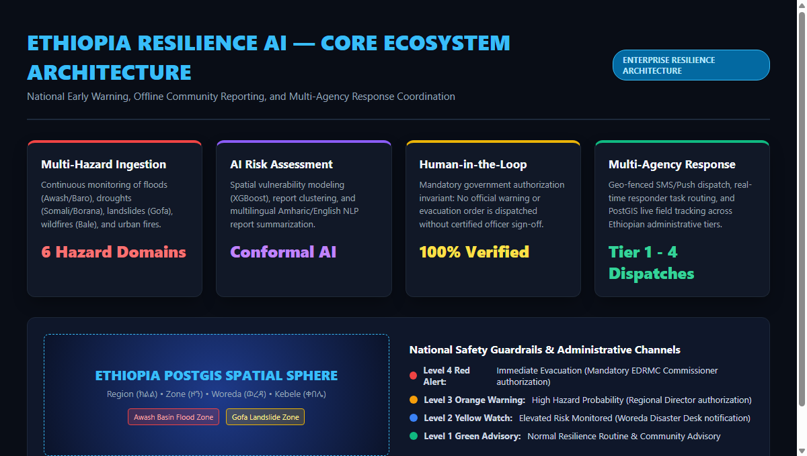

# ETHIOPIA RESILIENCE AI
## AI-Assisted National Disaster Early Warning, Community Reporting & Emergency Response Coordination Platform
### የኢትዮጵያ አደጋ ቅድመ ማስጠንቀቂያ፣ የማህበረሰብ ሪፖርት እና የአደጋ ጊዜ ምላሽ ቅንጅት መድረክ



[](#)
[](#)
[](#)
[](#)

---

## 1. Executive Summary

**ETHIOPIA RESILIENCE AI** is a mission-critical, enterprise-grade software platform engineered to transform disaster risk reduction and emergency management across the Federal Democratic Republic of Ethiopia.

The platform addresses severe national hazards:
1. **Riverine & Flash Floods:** Awash River Basin, Baro-Akobo, and Lake Tana floodplains.
2. **Debris Flows & Landslides:** High-risk highland slopes (such as Gofa Zone and Southern Ethiopia).
3. **Severe Droughts:** Pastoralist zones of Somali and Borana (Oromia).
4. **Wildfires:** Bale Mountains National Park and Afroalpine woodland ecosystems.
5. **High-Density Urban Fires:** Commercial hubs such as Addis Ababa Mercato.
6. **Severe Storms & Hail:** Damaging agricultural yields across regional farming corridors.

---

## 2. Core Pillars & Architectural Principles

### 1. Offline-First Community Reporting (የማህበረሰብ ሪፖርት)
Engineered for Ethiopian rural conditions characterized by intermittent 2G/3G connectivity. Community reporters capture geotagged photos, voice notes in Amharic, and casualty estimates directly into an encrypted local SQLite database. When cellular connectivity is restored, an exponential-backoff background sync synchronizes reports to the national PostGIS database with zero data loss.

### 2. Multi-Hazard AI Inference & Spatial Triage
An ensemble of XGBoost spatial risk estimators and fine-tuned multilingual natural language processing models processes incoming sensor streams from the Ethiopian Meteorology Institute (EMI) and crowd reports. The AI clusters redundant reports within a 1.5 km / 48-hour spatio-temporal buffer and generates calibrated risk probabilities with conformal uncertainty intervals.

### 3. Strict Safety Invariant: Human-in-the-Loop Early Warning (የሰው ውሳኔ ማረጋገጫ)
> [!IMPORTANT]
> **SAFETY INVARIANT (BR-01):** Artificial Intelligence models **CANNOT** automatically publish official warnings, public alerts, or evacuation directives. All high-level warnings (Levels 3 and 4) require physical ground verification by local woreda officers and explicit cryptographic sign-off by an authorized government commander (EDRMC or Regional DRMC Director).

### 4. Multi-Agency Emergency Response Coordination
Dispatches tactical orders to search & rescue battalions, the Ethiopian Red Cross Society, municipal fire brigades, and medical triage teams. Live GPS telemetry tracks field units across Ethiopian administrative tiers (Region &bull; Zone &bull; Woreda &bull; Kebele &bull; Community).

---

## 3. Package Structure

```
ETHIOPIA-RESILIENCE-AI/
├── README.md                          # Master Project Guide & Quickstart
├── docs/
│   ├── SRS.docx                       # Software Requirements Specification (Word)
│   ├── SRS.pdf                        # Software Requirements Specification (PDF)
│   ├── SDD.docx                       # Software Design Document (Word)
│   ├── SDD.pdf                        # Software Design Document (PDF)
│   ├── API_DOCUMENTATION.md           # OpenAPI 3.0 REST Endpoint Catalog
│   ├── DATABASE_DESIGN.md             # Complete PostGIS Data Dictionary
│   ├── TESTING_PLAN.md                # Multi-tier Test Strategy & Test Cases
│   └── PROJECT_ROADMAP.md             # 18-Month Phased Implementation Plan
├── diagrams/
│   ├── UML/                           # Use Case, Class, Sequence, Activity, State, Component, Deployment
│   ├── ERD/                           # PostGIS Entity Relationship Diagram
│   ├── ARCHITECTURE/                  # System, AI Pipeline, and Offline Sync Architecture
│   └── WORKFLOWS/                     # Early Warning and Emergency Response Lifecycles
├── database/
│   ├── schema.sql                     # Production PostgreSQL 15 + PostGIS DDL Scripts
│   └── sample_data.sql                # Realistic Seed Data for Ethiopian Regions & Hazards
├── ui-design/
│   ├── web/                           # 9 Responsive Web Console Wireframes & PNGs
│   ├── mobile/                        # 3 Offline Mobile App Screens (Expo/React Native)
│   └── mockups/                       # Composite Overview Presentation Mockups
└── assets/
    ├── logo/                          # Vector SVG and High-Res PNG Project Logos
    └── project-images/                # System Architecture Banners and Badges
```

---

## 4. Technology Stack

- **Frontend Web:** Next.js 14, React 18, TypeScript, Tailwind CSS, MapLibre GL / OpenStreetMap.
- **Mobile Client:** React Native, Expo, SQLite Local Cache, NetInfo Offline Watcher.
- **Backend API:** Python 3.11, Django 5.0, Django REST Framework, Celery Distributed Queue.
- **Database & Spatial Engine:** PostgreSQL 15, PostGIS 3.3 (EPSG:4326), pg_trgm.
- **In-Memory Cache & Broker:** Redis 7.2 Sentinel.
- **AI / ML Frameworks:** Python, Scikit-learn, XGBoost, PyTorch, Hugging Face Transformers.
- **Telecommunications:** Ethio Telecom SMPP Leased Line Gateway (Bulk SMS & Cell Broadcast).
- **Containerization & Cloud:** Docker, Docker Compose, Kubernetes, Nginx Reverse Proxy.

---

## 5. Quickstart & Deployment Guide

### Prerequisites
- Docker Engine 24.0+ and Docker Compose v2+
- PostgreSQL 15 with PostGIS extension enabled
- Python 3.11+
- Node.js 18+

### Initializing the System
```bash
# 1. Clone repository
git clone https://github.com/edrmc-ethiopia/ethiopia-resilience-ai.git
cd ethiopia-resilience-ai

# 2. Start PostgreSQL + PostGIS, Redis, and Django Backend
docker compose up -d postgres redis api celery-worker

# 3. Apply database migrations & seed realistic Ethiopian data
docker compose exec api python manage.py migrate
docker compose exec -T postgres psql -U postgres -d resilience_db < database/schema.sql
docker compose exec -T postgres psql -U postgres -d resilience_db < database/sample_data.sql

# 4. Launch Next.js Operations Console
cd frontend && npm install && npm run dev
```
Access the Operations Dashboard at `http://localhost:3000`.

---

## 6. Glossary of Ethiopian Disaster Management Terms

- **EDRMC (የኢትዮጵያ አደጋ ስጋት ስራ አመራር ኮሚሽን):** Ethiopian Disaster Risk Management Commission.
- **EMI (የኢትዮጵያ ሚቲዎሮሎጂ ኢንስቲትዩት):** Ethiopian Meteorology Institute.
- **ክልል (Region):** Top-level federal administrative state.
- **ዞን (Zone):** Second-tier administrative department.
- **ወረዳ (Woreda):** District disaster desk and tactical dispatch jurisdiction.
- **ቀበሌ (Kebele):** Local neighborhood association and ground verification committee.
- **ጎጥ (Gote / Community):** Sub-kebele settlement cluster.
- **የሰው ውሳኔ ማረጋገጫ (Human-in-the-Loop):** Mandatory governance safeguard requiring certified officer approval for all official public alerts.
